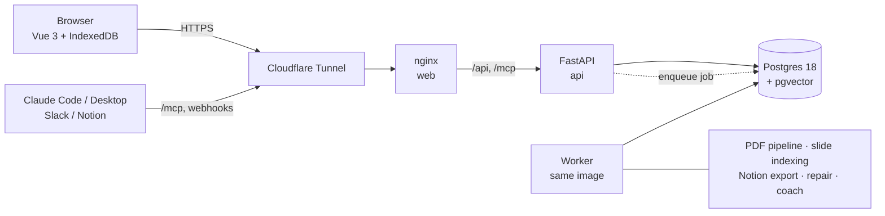

# exam-sim

**Turn old exam PDFs into timed, auto-graded practice exams, then into a study loop: search your slides, get quizzed by Claude or Slack, export weak spots to Anki and Notion.**

[](https://github.com/ersan-eke/exam-sim/actions/workflows/frontend.yml)


**Live demo:** https://exams.ersaneke.com

<!-- TODO: screenshot (timed exam view) -->
<!-- TODO: screenshot (graded result with rubric) -->

## What it does

**Exam pipeline**
- Upload an exam PDF and get a structured exam: tasks, subtasks, point values, multiple-choice options and clean page crops.
- Fully deterministic (no LLM): uploads are free and reproducible. Solution sheets are detected and linked to their exam, including MC answer keys read from ticked boxes.
- A repair agent fixes the rare structures whose points do not add up.

**Timed exams**
- Side outline, typed answers or a pen canvas, MC overlay, overtime handling, per-subtask time bars.
- Statistics per subject: trends, activity grid, weak topics.

**LLM grading with your own key**
- Anthropic, Google AI Studio or OpenRouter. The key stays on your device.
- Rubric-based results with a point range and a certainty flag. With a solution sheet it is the rubric; without one the model solves the task itself and says so.

**Sync**
- Local-first (IndexedDB) with a server mirror, so the same account works on every device.

**Ask over your slides (RAG)**
- Upload slides, scripts and exercises per subject; get an automatic outline, hybrid search and page-cited chat over pinned pages.

**MCP tutor**
- Point Claude Code or Claude Desktop at `/mcp`. Claude quizzes you on your own exams and records the results in the app.

**Slack `/quiz`**
- Quizzes your weakest subtasks with page crops, reveals verdict and solution on a button press.

**Anki and Notion export**
- Weak subtasks become an `.apkg` deck or a Notion database of crop cards.

**Study coach**
- Set an exam date per course; a scheduled job finds weak topics and nudges you via Slack DM and a Notion practice set.

## Architecture



One backend image runs as API (`uvicorn main:app`) or worker (`python -m app.worker.main`). Postgres is also the job queue.

## Interesting engineering

- **Postgres as the job queue.** `SELECT ... FOR UPDATE SKIP LOCKED`, stale-job reclaim and retries. No Redis, no Celery. Progress streams to the browser over SSE.
- **Deterministic PDF pipeline.** Task headers and subtask labels are confirmed by layout evidence (dominant header style, consistent indent). Points are parsed from many notations and cross-checked against subtask sums, task headers and the cover-page total. A 15-PDF smoke test guards every change.
- **Hybrid retrieval, scoped per subject.** pgvector cosine plus full-text, merged with Reciprocal Rank Fusion, using local multilingual embeddings (no API key). Every query is scoped to one user and one subject.
- **Grading output clamped server-side.** Points, min and max are forced into `0..max` with `min <= points <= max`, regardless of what the model returns. Request size, image type and rate are capped.
- **Bring-your-own key, never stored.** The LLM key travels per request in `X-LLM-Key` and is neither persisted nor logged.
- **Hardened compose.** No published ports, split `backend` / `edge` / `tunnel` networks, `cap_drop: ALL`, `no-new-privileges`, non-root backend, no access logs (query strings carry OAuth codes).
- **Slack done properly.** HMAC-SHA256 signature check with a 5-minute replay window, `event_id` de-duplication, Fernet-encrypted tokens with key rotation.
- **Add-only migrations.** Rollback runs an older image on the newer schema, so drops and renames wait a release.

## Tech stack

| Layer | Technology |
|---|---|
| Backend | Python 3.13, FastAPI, SQLAlchemy 2, Alembic, uv, pdfplumber, Authlib |
| Database | Postgres 18, pgvector, full-text search |
| Retrieval | fastembed (`paraphrase-multilingual-MiniLM-L12-v2`), RRF |
| Frontend | Vue 3, Pinia, Vue Router, TypeScript, Vite, Vitest, IndexedDB |
| Integrations | MCP (streamable HTTP), Slack, Anki, Notion, Anthropic / Google / OpenRouter |
| Ops | Docker Compose, nginx, Cloudflare Tunnel, GitHub Actions, GHCR |

## Run it locally

```bash
# database (pgvector/pgvector:pg18)
docker compose up -d db

# backend, from backend/ (uv only)
cd backend
uv sync
uv run alembic upgrade head
uv run uvicorn main:app
uv run python -m app.worker.main     # in a second terminal

# frontend, from frontend/
cd frontend
npm run dev                          # proxies /api and /mcp
```

Tests and lint:

```bash
cd backend && uv run pytest          # needs the DB, uses examsim_test
cd backend && ruff check . && ruff format .
cd frontend && npx vitest run
```

Pipeline changes: `uv run python -m app.pipeline.smoke` (from `backend/`).

## How it was built

Work ran one phase per session: spec, then plan, then subagent implementation with a review after every task, then code and security review, then verify and commit. Every phase ends with a handoff doc (done / not done / decisions already made).

- Roadmap and phase status: [docs/roadmap.md](docs/roadmap.md)
- Specs and plans: [docs/superpowers/](docs/superpowers/)
- Handoffs, for example [phase 6a hosting](docs/2026-11-26-phase-6a-stage1-handoff.md), [Notion](docs/2026-11-25-phase-5b2-handoff.md), [Slack](docs/2026-11-20-phase-5a-handoff.md), [RAG](docs/2026-11-05-rag-handoff.md)
- Unfixed review findings: [docs/findings.md](docs/findings.md); project vocabulary: [GLOSSARY.md](GLOSSARY.md)

## Guides

[MCP tutor](docs/mcp.md) · [Slack](docs/slack.md) · [Anki](docs/anki.md) · [Notion](docs/notion.md) · [Hosting and security](docs/hosting.md)

## Notes

Exam PDFs and page crops are never committed (copyright): `samples/`, `results/` and `*.pdf` are git-ignored.

License: TBD
