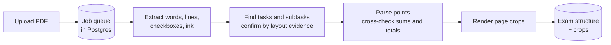
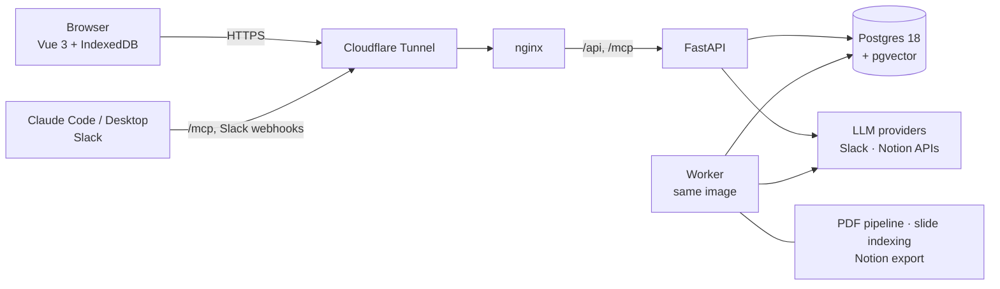

<div align="center">

# exam-sim

Practice old exams as timed exams, have an LLM grade them against the official solution,
and get quizzed on the subtasks you keep getting wrong.

[](https://github.com/ersan-eke/exams/actions/workflows/frontend.yml)
[](LICENSE)


[Live instance](https://exams.ersaneke.com) · [Features](#features) · [Evaluation](#evaluation) · [Architecture](#architecture) · [Run locally](#run-it-locally) · [Repository layout](#repository-layout)

</div>

---

exam-sim is a self-hosted exam practice app. It parses old exam PDFs into tasks, subtasks and point values, runs them
as timed exams, and grades each answer with an LLM, using the official solution sheet when one is available. Grades are
stored per subtask, so the Slack quiz, the Claude tutor and the flashcard exports can focus on the weakest ones.

> [!NOTE]
> exam-sim is a personal project in active development. The live instance is invite-only. Exam PDFs are not included
> for copyright reasons; you upload your own.

## Features

| | |
|---|---|
| PDF → exam | Upload a PDF and get tasks, subtasks, point values, multiple-choice (MC) options and page crops. No LLM is involved, so uploads need no API key and are deterministic. Solution sheets are detected and linked to their exam, and MC answer keys are read from the ticked boxes. |
| Timed exams | Outline sidebar, typed answers or a pen canvas, clickable MC boxes on the page, optional overtime after the timer runs out, and the time spent per subtask. Statistics show totals, average time and score per question, and an activity grid. |
| LLM grading | Anthropic, Google AI Studio or OpenRouter, with your own API key. Each grade has points and, when the answer is ambiguous, a range (for example 1–2 of 3) and an uncertainty mark. With a solution sheet, the model grades against it. Without one, it solves the task first and says so. |
| Sync | Data is stored in the browser (IndexedDB) and mirrored to the server, so one account works on all devices. |
| Slide search and chat | Upload lecture slides, lecture notes and exercise sheets per subject. The app builds an outline, offers a search that works without an LLM, and has a chat that answers only from the pages you pin and cites them. |
| Claude tutor (MCP) | Connect Claude Code or Claude Desktop to the app's MCP (Model Context Protocol) server at `/mcp`. Claude quizzes you on your own exams; a progress tool lists your weakest tasks first, so it can start there. The results show up in the app. |
| Slack `/quiz` | Sends one of your weakest subtasks with its page crop. A button reveals the verdict and the solution. |
| Anki and Notion | Subtasks scored below 60% can be exported as an `.apkg` deck or a Notion database. |

Not built yet (see the [roadmap](docs/roadmap.md)): a public demo mode, an agent that repairs the few parsed exams
whose points do not add up, and a study coach that sends reminders about weak topics before an exam.

## Evaluation

### Agreement with human grading

The test set is the author's own exams, already graded by the course staff, scanned and paired with the official
solution PDFs. An importer cuts each subtask's answer out of the scan and removes the graders' red and green marks, so
the model cannot read the grade off the page. The printed points are the expected result. Multiple-choice subtasks are
left out because they are graded without an LLM. Exams whose parsed points do not add up to the cover-page total are
left out too, as are subtasks without a clearly matching printed score.

Settings: `claude-haiku-5-5`, grading prompt version `2026-11-05.1`, one run, no prompt tuning.

| Graded against | Subtasks (6 exams) | Same points as the grader | Within 1 point | Mean abs. error |
|---|---|---|---|---|
| the official solution | 134 | 71% | 97% | 0.28 points |
| a solution the model wrote itself | 134 | 58% | 94% | 0.42 points |

The set covers one student's exams in a single run, so the numbers are indicative and may shift with more data. The
[eval notes](docs/2026-11-26-grading-eval-handoff.md) contain the method, all metrics and a second set of 107
transcribed answers from four exams the importer could not use. The harness is in
[`backend/evals/grading/`](backend/evals/grading/README.md).

### Text instead of images

Each region of a subtask is sent to the model as text unless it needs to be an image (a figure, a table,
handwriting). On the sample exams this reduced the share of regions sent as images from 59.5% to 37.9%, and the
estimated size of a grading request from 1,018 to 836 tokens. The script is `backend/evals/text_first/measure.py`.

### Pipeline checks

A smoke test on 15 selected PDFs runs after every pipeline edit (through a Claude Code hook) and takes about 13
seconds. Before a pipeline change is merged, the pipeline CLI runs on the full sample set: 306 PDFs, exams and their
solution sheets, from 12 courses. Both need the PDFs in a local `samples/` folder, which is not part of the repository.

## How a PDF becomes an exam



## Architecture



The same backend image runs either the API (`uvicorn main:app`) or the worker (`python -m app.worker.main`). The
browser receives job progress over Server-Sent Events (SSE).

## Implementation notes

- The job queue is a Postgres table read with `SELECT … FOR UPDATE SKIP LOCKED`. Stalled jobs are picked up again,
  and a failed job is retried up to three times. There is no Redis or Celery.
- The PDF parser only accepts a task header or subtask label if the layout agrees (a header style that repeats across
  the exam, a consistent indent). Points come in many notations (`(2 Punkte)`, `2P+2P=4P`, `je 1P`, `/21`) and are
  checked against the subtask sums, the task headers and the cover-page total.
- Slide search combines pgvector cosine similarity with Postgres full-text search through Reciprocal Rank Fusion. The
  embeddings are computed locally with a multilingual model, so search needs no API key. Every query is limited to
  one user and one subject.
- The server clamps the model's points to `0..max` for the subtask and keeps the range around them
  (`points_min ≤ points ≤ points_max`). Request size, image type and request rate are limited.
- The LLM key is sent with each request in an `X-LLM-Key` header. The server does not store or log it.
- In production no port is published; traffic arrives only through a Cloudflare Tunnel. The containers sit on separate
  `backend` / `edge` / `tunnel` networks with `cap_drop: ALL` and `no-new-privileges`, and run as non-root users.
  Access logs are off, because query strings can contain OAuth codes.
- Slack requests are verified with HMAC-SHA256 and rejected when older than five minutes. Duplicate events are dropped
  by `event_id`, and stored Slack tokens are encrypted with Fernet, with key rotation.
- Login uses GitHub or Google OAuth with PKCE and server-side sessions. Only emails on an allowlist can sign in
  (production requires the list). MCP uses personal access tokens that are stored hashed and can be revoked.
- Migrations add tables, nullable columns and indexes, so a rollback can run an older image on a newer schema. Drops
  and renames wait until no deployed image needs the old shape.

## Tech stack

| Layer | Technology |
|---|---|
| Backend | Python 3.13, FastAPI, SQLAlchemy 2, Alembic, uv, pdfplumber, Authlib |
| Data | Postgres 18, pgvector, full-text search |
| Retrieval | fastembed (`paraphrase-multilingual-MiniLM-L12-v2`), Reciprocal Rank Fusion |
| Frontend | Vue 3, Pinia, Vue Router, TypeScript, Vite, Vitest, IndexedDB |
| Integrations | MCP (streamable HTTP), Slack, Anki, Notion, Anthropic / Google / OpenRouter |
| Ops | Docker Compose, nginx, Cloudflare Tunnel, GitHub Actions (frontend image to GHCR) |

## Run it locally

Requirements: Docker, [uv](https://docs.astral.sh/uv/) and Node 20.19+ or 22.12+.

```bash
# 1. database (pgvector/pgvector:pg18)
docker compose up -d db

# 2. backend, from backend/ (uv only, no pip)
cd backend
cp .env.example .env                 # add OAuth / integration keys if needed
uv sync
uv run alembic upgrade head
uv run uvicorn main:app

# 3. worker, in a second terminal (processes uploads and slide uploads)
cd backend && uv run python -m app.worker.main

# 4. frontend, in a third terminal from the repository root
cd frontend
npm install
npm run dev                          # proxies /api and /mcp to the backend
```

Tests and lint:

```bash
cd backend && uv run pytest                 # needs the DB, uses examsim_test
cd backend && uvx ruff check . && uvx ruff format .
cd frontend && npx vitest run
cd backend && uv run python -m app.pipeline.smoke   # after pipeline changes; needs your own PDFs in samples/
```

## Repository layout

| Path | Contents |
|---|---|
| `backend/` | FastAPI app (`app/`), PDF pipeline (`app/pipeline/`), worker, Alembic migrations, tests, evals (`evals/`) |
| `frontend/` | Vue 3 app and its nginx config |
| `deploy/` | Production compose file |
| `docs/` | Roadmap, design specs and plans, notes written at the end of each feature, integration guides |
| `scripts/` | The script that publishes this public copy |
| `CLAUDE.md`, `.claude/` | Instructions and settings for [Claude Code](https://claude.com/claude-code), used to build the project |
| `graphify-out/` | A graph of the code that is regenerated automatically. Coding agents query it to find their way around; it can be ignored. |

## Development

The project is built with Claude Code, one feature at a time. Each feature starts with a design spec and an
implementation plan. Claude Code subagents implement it task by task, with a review after each task, then a code
review, a security review where keys, auth or webhooks are involved, and a final manual check. Each feature ends with
a note on what is done, what is not, and which decisions are final.

- [Roadmap and status](docs/roadmap.md)
- [Design specs](docs/superpowers/specs/) and [implementation plans](docs/superpowers/plans/)
- End-of-feature notes, for example on the [grading eval](docs/2026-11-26-grading-eval-handoff.md),
  [hosting](docs/2026-11-26-phase-6a-stage1-handoff.md), [Notion](docs/2026-11-25-phase-5b2-handoff.md),
  [Slack](docs/2026-11-20-phase-5a-handoff.md) and [slide search](docs/2026-11-05-rag-handoff.md)
- [Open review findings](docs/findings.md) and a [glossary](GLOSSARY.md)

Guides: [Claude tutor (MCP)](docs/mcp.md) · [Slack](docs/slack.md) · [Anki](docs/anki.md) · [Notion](docs/notion.md) · [Hosting and security](docs/hosting.md)

## Exam material

Exams are copyrighted, so the repository contains no exam PDFs or page crops. `samples/`, `results/`, `*.pdf` and the
graded scans in `backend/evals/grading/private/` are git-ignored.

## License

[MIT](LICENSE)
