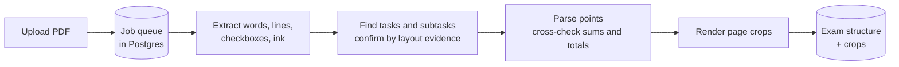
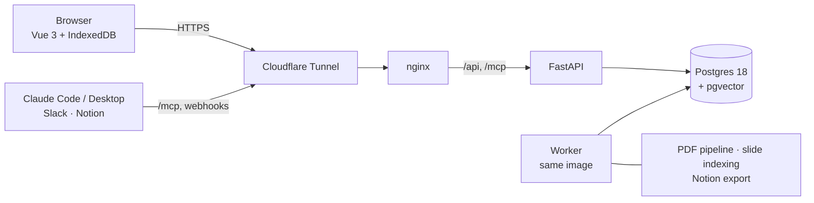

<div align="center">

# exam-sim

**Turn old exam PDFs into timed, auto-graded practice exams, then into a study loop.**<br/>
Search your slides, get quizzed by Claude or Slack, export your weak spots to Anki and Notion.

[](https://github.com/ersan-eke/exams/actions/workflows/frontend.yml)
[](LICENSE)


[**Live demo**](https://exams.ersaneke.com) · [Features](#features) · [Architecture](#architecture) · [Engineering](#engineering-highlights) · [Run locally](#run-it-locally) · [Docs](#documentation)

</div>

---

## Why

Old exams are the best study material there is, but they are PDFs: you can't time yourself, mark them, search across them or track what you keep getting wrong. exam-sim reads the PDF, rebuilds it as a structured exam, and then treats your whole course as data: every answer, grade, slide and weak spot feeds the next study session.

## Features

| | |
|---|---|
| **PDF → exam** | Upload a PDF and get tasks, subtasks, point values, multiple-choice options and clean page crops. The pipeline is deterministic (no LLM), so uploads are free and reproducible. Solution sheets are detected and linked, including MC answer keys read from ticked boxes. |
| **Timed exams** | Side outline, typed answers or a pen canvas, MC overlay, overtime handling and per-subtask time bars. Statistics per subject: trends, activity grid, weak topics. |
| **LLM grading** | Anthropic, Google AI Studio or OpenRouter, **with your own key**. Rubric-based results with a point range and a certainty flag. With a solution sheet, the solution is the rubric; without one, the model solves the task itself and says so. |
| **Sync** | Local-first (IndexedDB) with a server mirror, so the same account works on every device. |
| **Ask your slides** | Upload slides, scripts and exercises per subject. Get an automatic outline, hybrid search that needs no LLM, and a page-cited chat over the pages you pin. |
| **MCP tutor** | Point Claude Code or Claude Desktop at `/mcp`. Claude quizzes you on your own exams, targets your weak spots and records the results in the app. |
| **Slack `/quiz`** | Quizzes your weakest subtasks with page crops, then reveals verdict and solution on a button press. |
| **Anki and Notion** | Weak subtasks become an `.apkg` deck or a Notion database of crop cards. |

Planned ([roadmap](docs/roadmap.md)): a repair agent for the rare structures whose points don't add up, and a study coach that nudges you about weak topics before an exam date.

## How a PDF becomes an exam



## Architecture



One backend image runs as the API (`uvicorn main:app`) or as the worker (`python -m app.worker.main`). Postgres is also the job queue, and progress streams to the browser over SSE.

## Engineering highlights

- **Postgres as the job queue.** `SELECT … FOR UPDATE SKIP LOCKED`, stale-job reclaim and retries. No Redis, no Celery.
- **Deterministic PDF pipeline.** Task headers and subtask labels are confirmed by layout evidence (dominant header style, consistent indent). Points are parsed from many notations (`(2 Punkte)`, `2P+2P=4P`, `je 1P`, `/21`) and cross-checked against subtask sums, task headers and the cover-page total. A 15-PDF smoke test guards every change.
- **Hybrid retrieval, scoped per subject.** pgvector cosine plus full-text search, merged with Reciprocal Rank Fusion, using local multilingual embeddings (no API key). Every query is scoped to one user and one subject, so nothing leaks across courses or accounts.
- **Grading you can trust.** Points, minimum and maximum are clamped server-side to `0..max` with `min ≤ points ≤ max`, whatever the model returns. Request size, image type and rate are capped, and an eval harness measures agreement and calibration. On 134 subtasks from 6 real teacher-graded exams, Claude Haiku grading against the official solution matched the teacher's points exactly on 71% and came within 1 point on 97%.
- **Bring your own key, never stored.** The LLM key travels per request in `X-LLM-Key` and is neither persisted nor logged.
- **Hardened deployment.** No published ports, split `backend` / `edge` / `tunnel` networks, `cap_drop: ALL`, `no-new-privileges`, a non-root backend and no access logs (query strings carry OAuth codes).
- **Webhooks done properly.** Slack requests are verified with HMAC-SHA256 and a 5-minute replay window, de-duplicated by `event_id`, and stored tokens are Fernet-encrypted with key rotation.
- **Invite-only auth.** GitHub and Google OAuth with PKCE, server-side sessions, an email allowlist checked before any account exists, and revocable hashed tokens for MCP.
- **Add-only migrations.** Rollback runs an older image on the newer schema, so drops and renames wait a release.

## Tech stack

| Layer | Technology |
|---|---|
| Backend | Python 3.13, FastAPI, SQLAlchemy 2, Alembic, uv, pdfplumber, Authlib |
| Data | Postgres 18, pgvector, full-text search |
| Retrieval | fastembed (`paraphrase-multilingual-MiniLM-L12-v2`), Reciprocal Rank Fusion |
| Frontend | Vue 3, Pinia, Vue Router, TypeScript, Vite, Vitest, IndexedDB |
| Integrations | MCP (streamable HTTP), Slack, Anki, Notion, Anthropic / Google / OpenRouter |
| Ops | Docker Compose, nginx, Cloudflare Tunnel, GitHub Actions, GHCR |

## Run it locally

You need Docker, [uv](https://docs.astral.sh/uv/) and Node.

```bash
# 1. database (pgvector/pgvector:pg18)
docker compose up -d db

# 2. backend, from backend/ (uv only, no pip)
cd backend
cp .env.example .env                 # add OAuth / integration keys if you want them
uv sync
uv run alembic upgrade head
uv run uvicorn main:app

# 3. worker, in a second terminal (processes uploads and slide decks)
cd backend && uv run python -m app.worker.main

# 4. frontend, from frontend/
cd frontend
npm install
npm run dev                          # proxies /api and /mcp to the backend
```

Tests and lint:

```bash
cd backend && uv run pytest                 # needs the DB, uses examsim_test
cd backend && ruff check . && ruff format .
cd frontend && npx vitest run
cd backend && uv run python -m app.pipeline.smoke   # after pipeline changes
```

## How it was built

One phase per session: a spec, then a plan, then subagent implementation with a review after every task, then code and security review, then verification. Every phase ends with a handoff doc listing what is done, what is not and which decisions are settled.

- [Roadmap and phase status](docs/roadmap.md)
- [Specs and plans](docs/superpowers/)
- Handoffs, for example [grading eval on real exams](docs/2026-11-26-grading-eval-handoff.md), [hosting](docs/2026-11-26-phase-6a-stage1-handoff.md), [Notion](docs/2026-11-25-phase-5b2-handoff.md), [Slack](docs/2026-11-20-phase-5a-handoff.md) and [RAG](docs/2026-11-05-rag-handoff.md)
- [Open review findings](docs/findings.md) and the project [glossary](GLOSSARY.md)

## Documentation

[MCP tutor](docs/mcp.md) · [Slack](docs/slack.md) · [Anki](docs/anki.md) · [Notion](docs/notion.md) · [Hosting and security](docs/hosting.md)

## A note on exam material

Exam PDFs and page crops are never committed, for copyright reasons: `samples/`, `results/`, `*.pdf` and the graded scans in `backend/evals/grading/private/` are git-ignored. You bring your own exams.

## License

[MIT](LICENSE)
